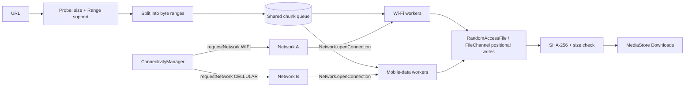

# Faster Downloads

An Android app that downloads **one file over two networks at the same time** — Wi-Fi *and*
mobile data — by splitting the file into HTTP `Range` chunks and pinning each group of
sockets to a different radio with Android's `Network` API.

This is the Plexo idea (multipath downloads over bonded links, see
[anmolkapil/plexo](https://github.com/anmolkapil/plexo)) rebuilt for Android, where apps
cannot use `SO_BINDTODEVICE` and instead ask `ConnectivityManager` for two live `Network`
objects and route each connection through one of them.


**[Download the latest APK](https://github.com/owaiskhan-ash/Faster-Downloads/releases/latest)**

---

## Install

1. Open the [latest release](https://github.com/owaiskhan-ash/Faster-Downloads/releases/latest).
2. Download `FasterDownloads-<version>.apk` on the phone.
3. Allow *install unknown apps* for your browser/file manager, then open the APK.

Requirements: Android 8.0 (API 26) or newer.

## How it works



1. **Two networks at once.** `ConnectivityManager.requestNetwork()` is called once for
   `TRANSPORT_WIFI` and once for `TRANSPORT_CELLULAR`. Both callbacks stay registered for
   the whole transfer, so the platform keeps the cellular link up even though Wi-Fi is the
   default network.
2. **Sockets bound per radio.** Every request is opened with `Network.openConnection(url)`,
   which is Android's equivalent of `SO_BINDTODEVICE`: DNS and TCP traffic for that
   connection leave through that network only.
3. **Range splitting.** The file is probed with `Range: bytes=0-0` to learn its size and
   whether the server honours ranges. It is then cut into 256 KB – 8 MB chunks that all
   land in one shared work queue.
4. **Weighted, adaptive workers.** Each radio gets a share of the worker threads
   (default 70 % Wi-Fi / 30 % mobile). Every 4 s the app compares measured throughput
   against the requested split and hands the faster radio an extra worker if it is
   under-used. A stalled link never blocks the other one, because work is pulled, not
   pushed.
5. **Reassembly and verification.** Chunks are written with positional `FileChannel`
   writes, so no lock is needed and threads never collide. The finished file is checked
   against the expected length and hashed with SHA-256 before being published to
   `Download/FasterDownloads/` through MediaStore.
6. **Resumable.** Completed chunk indexes are journalled to disk every few seconds, so a
   cancelled or interrupted transfer continues from where it stopped instead of starting
   over.
7. **Foreground service.** The transfer runs in a `dataSync` foreground service with a
   progress notification, cancel action and a partial wake lock.

More detail: [docs/ARCHITECTURE.md](docs/ARCHITECTURE.md).

## Features

- Bonded Wi-Fi + mobile-data download with a configurable Wi-Fi share (50–90 %)
- 1–8 parallel connections per network, shared work queue with retry
- Adaptive weighting driven by real per-link throughput
- Chunk-level resume after cancellation, process death or network loss
- SHA-256 of the finished file plus exact size verification
- Saves to `Download/FasterDownloads` (MediaStore on Android 10+, direct file on 8–9)
- Foreground service with progress notification and in-notification cancel
- Automatic fallback to a single connection when the server ignores `Range`

## Caveats

- **Range support is required** for the multipath path. Hosts that ignore `Range` fall
  back to one connection (still 1 stream, no speedup).
- **OEM skins vary.** A few Android skins restrict concurrent Wi-Fi + cellular use or tear
  down the secondary network. Behaviour was designed against stock Android 8–15; test on
  your device.
- **Mobile data is really consumed** while bonded — typically `100 - wifiShare` percent of
  the bytes. Watch your data cap. Carrier billing and tethering rules apply.
- **Battery.** Two radios plus several sockets drain faster than a normal download.
- The release APK is **debug-signed** unless you provide signing secrets (see below), which
  is fine for sideloading but not for publishing to Play.

## Build from source

```bash
git clone https://github.com/owaiskhan-ash/Faster-Downloads.git
cd Faster-Downloads
./gradlew :app:assembleDebug      # app/build/outputs/apk/debug/
./gradlew :app:testDebugUnitTest  # chunk-planning and formatting tests
```

Requires JDK 17 and the Android SDK (compileSdk 35). Opening the project in Android Studio
works as-is.

### Signed releases

CI builds an installable APK on every push. To produce a properly signed release, add these
repository secrets and push a `v*` tag (or a commit whose message contains `[release]`):

| Secret | Purpose |
| --- | --- |
| `KEYSTORE_BASE64` | `base64 -w0 release.keystore` |
| `KEYSTORE_PASSWORD` | keystore password |
| `KEY_ALIAS` | key alias |
| `KEY_PASSWORD` | key password |

Without them the release job signs with the debug key and says so in the release notes.

## Project layout

```
app/src/main/java/com/fasterdownloads/
  core/NetworkLinks.kt        ConnectivityManager → two bound Network handles
  core/HttpUtil.kt            network-pinned connections, probe, redirects, filenames
  core/ChunkPlan.kt           pure chunk-size / worker-split math (unit tested)
  core/MultiPathDownloader.kt the engine: queue, workers, retries, resume, verify
  core/Storage.kt             MediaStore publishing (and pre-Q fallback)
  core/DownloadController.kt  StateFlow bridge between service and UI
  service/DownloadService.kt  foreground service, notification, wake lock
  ui/HomeScreen.kt            Compose UI
.github/workflows/android.yml tests → APKs → optional release
```

## Roadmap

- [ ] Per-request bandwidth caps and a data-usage budget for mobile
- [ ] Multiple queued downloads
- [ ] Share-sheet / intent receiver for URLs
- [ ] Optional server-side checksum verification (ETag / `Digest` header)
- [ ] Wi-Fi + Wi-Fi (dual-band) bonding on supported devices

## License

MIT — see [LICENSE](LICENSE).
